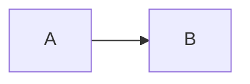

# Leitor Markdown

Um visualizador local em **C**, com interface **Motif** e texto desenhado por Xft.

## Leitura sem editor

- Abra seus arquivos .md.
- Leia o conteúdo formatado.
- Ative RAW para consultar a marcação original.

> Este é um protótipo separado do Arquivo Pessoal e dos demais projetos.

### Formatação básica

Texto com **negrito**, *itálico* e `código em linha`.

1. Primeiro item
2. Segundo item

```c
#include <stdio.h>

int main(void) {
    puts("Olá, Steven!");
    return 0;
}
```

[Exemplo de link](https://example.org)


---

## O que ainda aparece como texto

| Item | Situação |
|---|---|
| Tabela | Sem diagramação especial |

$$ E = mc^2 $$



Esses exemplos não significam suporte a tabelas gráficas, matemática ou Mermaid.
